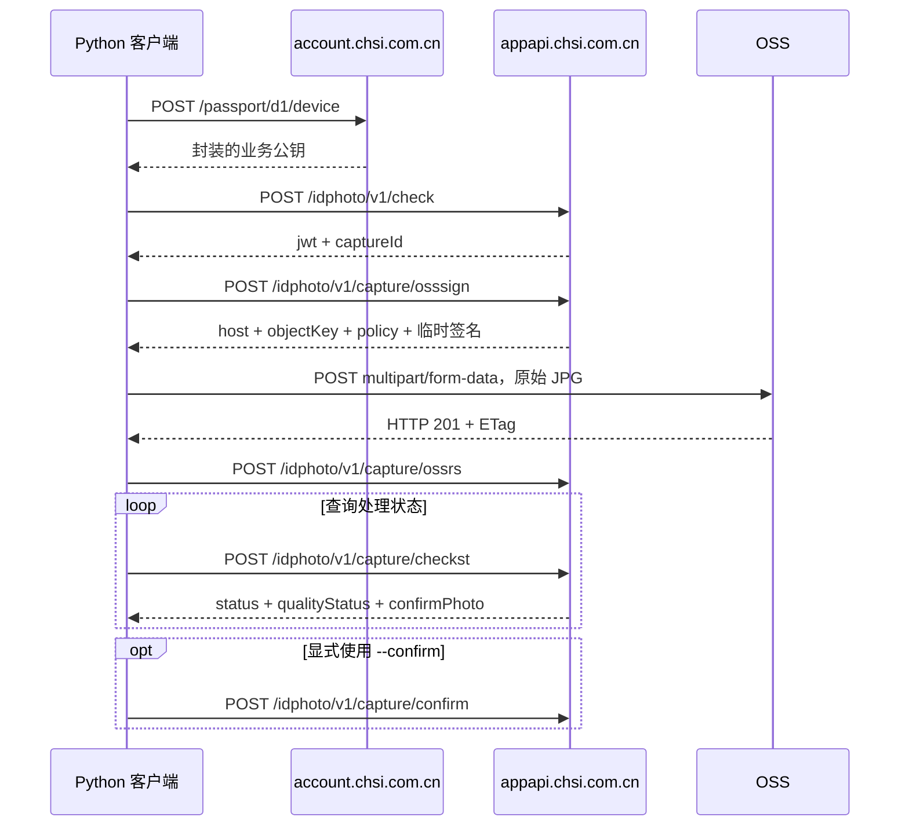

# chsi-idphoto

从 CHSI App 2.6.1 的运行时 DEX 分析得到的照片采集协议，以及一个可在电脑上运行的 Python `requests` 客户端。

输入手动扫描得到的 `chesicc://idphoto/...` 字符串和 JPG 路径，即可上传原文件、回传 OSS 结果并查询处理状态。客户端不做人脸、眨眼、背景或清晰度检测，不裁切、不重编码照片；服务器仍会处理和检查照片。

## 已验证的范围

2026-10-21，以本人采集任务的二维码和预先拍摄的 JPEG 完成了真实调用：

- 二维码校验和上传签名申请成功。
- OSS 返回 HTTP `201`，回传 ETag 成功。
- 服务端返回 `qualityStatus: PASS`、`confirmPhoto: 1`。
- 报名网页的采集记录中出现了上传的照片。

上述调用没有执行 `capture/confirm`。网页的“设为报名照片”是另一操作。本仓库没有证明任意非人像图片、PNG/HEIC 等编码都能通过业务检查，也没有还原 App 的全部 native 方法。

本次观察到的 `DEFAULT` 上传策略限制文件大小为 **1,024～1,048,576 字节（1 KiB～1 MiB）**。服务器最大像素尺寸尚未确定；App 的 `480×640` 裁剪输出与 `100–300 KiB` 压缩目标不等于服务端硬限制。详见 [分析结论](docs/findings.md)。

## 快速开始

需要 Python 3.10 或更新版本：

```shell
python -m venv .venv
# 先按操作系统激活 .venv，然后安装依赖：
python -m pip install -r requirements.txt
python chsi_idphoto.py --wait 120
```

按提示粘贴二维码和 JPG 路径，也可通过位置参数传入：

```shell
python chsi_idphoto.py 'chesicc://idphoto/替换为新二维码内容' './portrait.jpg' --wait 120
```

默认完成上传并回传 ETag。`--wait` 表示继续查询处理状态；默认 `--bg DEFAULT` 保留原图，`--bg WHITE` 请求后台辅助换白底。

仅在需要调用 App 的最终确认接口时使用 `--confirm`：

```shell
python chsi_idphoto.py 'chesicc://idphoto/本次二维码内容' './portrait.jpg' --confirm
```

脚本只在服务器返回 `QUALITY_CHECKING` 且 `confirmPhoto=1` 时调用确认。它不操作报名网页上的照片选用。

### 一次性二维码与恢复状态

**`check` 成功会消耗二维码，即使照片还没上传。** 脚本在校验成功后立即保存 JWT 与采集编号，重试相同命令时复用凭证。

默认状态保存在运行命令的当前目录：

```text
.chsi-idphoto-state.json     安装 UUID
.chsi-idphoto-sessions/      任务 JWT、签名和进度
```

重试时应保留上述文件并使用相同工作目录；也可用 `--state` 和 `--session-dir` 指定固定位置。如果校验请求发出后没有拿到响应，脚本会将结果标为不确定，停止自动重扫。

仓库不携带现成任务凭证，状态路径已加入 `.gitignore`。报告请放在被忽略的 `reports/` 中，例如 `--report reports/run.json`。

### 离线演练

```shell
python chsi_idphoto.py 'chesicc://idphoto/local+token/with.slash==' './portrait.jpg' --dry-run --wait 1
```

使用临时 RSA 密钥，在内存中模拟初始化、请求解密、OSS 表单、回执和状态查询，并核对 multipart 中的 JPG 字节。`--dry-run` 不发网络请求、不消耗二维码。

只调用公开初始化接口，不发送二维码或照片：

```shell
python chsi_idphoto.py --bootstrap-only
```

完整参数见 `python chsi_idphoto.py --help`。

## 调用链



协议字段、加密封装及错误语义见 [协议说明](docs/protocol.md)。

## 仓库内容

```text
chsi_idphoto.py           上传客户端及离线模拟器
requirements.txt         客户端依赖
docs/
  protocol.md            接口、请求加密、OSS 上传和确认
  findings.md            已确认事实、未知项、文件/格式限制
  reverse-engineering.md 静态分析、运行时 DEX、字符串恢复过程
  runtime-tools.md       本地分析工具的使用方法
  verification.md        历史验证记录与复现边界
  github.md              建立远程仓库与推送方法
examples/                脱敏结构样例，不含有效凭证
analysis/provenance.json APK/DEX 哈希及分析元数据，不含二进制
tools/                   自行编写的提取、盘点和字符串辅助工具
```

原 APK、DEX、第三方 App 源码及大型内存映射保留在本地分析资料中，仓库只分发自行编写的工具、说明和脱敏元数据。准备 GitHub 推送的步骤见 [GitHub 说明](docs/github.md)。

## 许可

自行编写的代码与文档采用 [MIT License](LICENSE)。第三方资料与依赖的范围见 [NOTICE](NOTICE.md)。
